# Modelo lógico de datos

## Diccionario de tablas

| Tabla | Propósito |
|---|---|
| `pais` | Catálogo de países de residencia |
| `departamento` | Departamentos de la VP de Finanzas |
| `nivel` | Catálogo de seniority |
| `cargo` | Puesto dentro de un departamento |
| `funcion` | Catálogo de funciones |
| `cargo_funcion` | Tabla asociativa cargo ↔ función |
| `colaborador` | Ficha laboral de cada persona |
| `rol` | Roles de acceso (Administrador, Jefe de Departamento, Colaborador) |
| `usuario` | Credencial de acceso al portal |

## Diagrama

```mermaid
erDiagram
    pais         ||--o{ colaborador   : ""
    rol          ||--o{ usuario       : ""
    colaborador  ||--o| usuario       : ""
    cargo        ||--o{ colaborador   : ""
    departamento ||--o{ cargo         : ""
    nivel        ||--o{ cargo         : ""
    cargo        ||--o{ cargo_funcion : ""
    funcion      ||--o{ cargo_funcion : ""

    pais {
        integer pais_id PK
        varchar codigo_iso UK
        varchar nombre UK
    }
    rol {
        integer rol_id PK
        varchar nombre UK
    }
    usuario {
        integer usuario_id PK
        integer colaborador_id FK, UK
        integer rol_id FK
        varchar hashed_password
        boolean activo
    }
    colaborador {
        integer colaborador_id PK
        integer pais_id FK
        integer cargo_id FK
        varchar correo UK
        varchar nombre
        varchar apellido
        date fecha_ingreso
        boolean activo
    }
    departamento {
        integer departamento_id PK
        varchar nombre UK
    }
    cargo {
        integer cargo_id PK
        integer departamento_id FK
        integer nivel_id FK
        varchar titulo
    }
    nivel {
        integer nivel_id PK
        varchar nombre UK
    }
    cargo_funcion {
        integer cargo_id PK, FK
        integer funcion_id PK, FK
    }
    funcion {
        integer funcion_id PK
        varchar descripcion UK
    }
```

