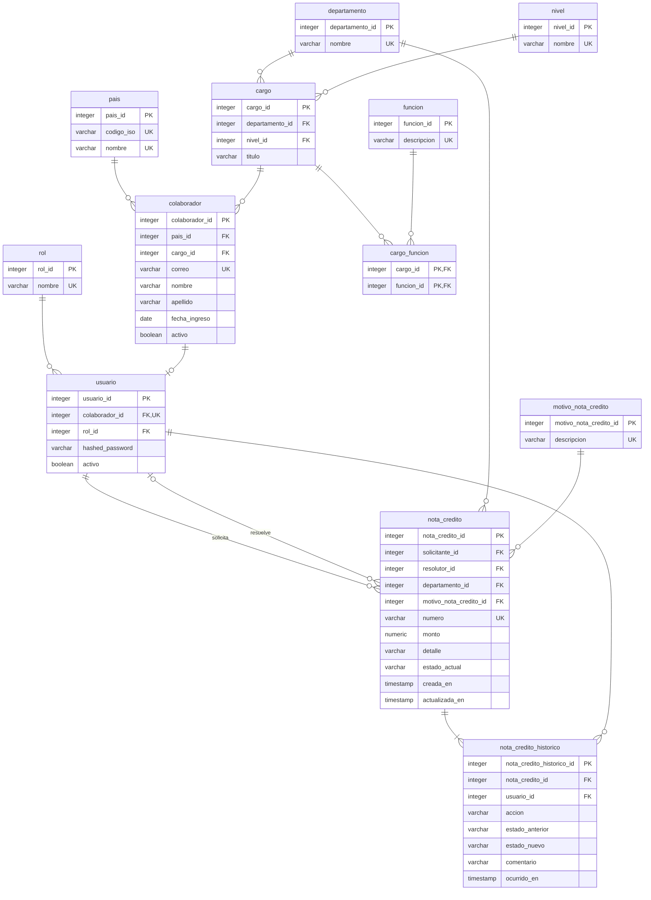

# Modelo lógico de datos

## Diccionario de tablas

| Tabla | Propósito |
|---|---|
| `pais` | Catálogo de países de residencia |
| `departamento` | Departamentos de la VP de Finanzas |
| `nivel` | Catálogo de seniority |
| `cargo` | Puesto dentro de un departamento |
| `funcion` | Catálogo de funciones |
| `cargo_funcion` | Tabla asociativa cargo ↔ función |
| `colaborador` | Ficha laboral de cada persona |
| `rol` | Roles de acceso (Administrador, Jefe de Departamento, Colaborador) |
| `usuario` | Credencial de acceso al portal |
| `motivo_nota_credito` | Catálogo de motivos de las notas de crédito |
| `nota_credito` | Solicitud de nota de crédito y su estado actual |
| `nota_credito_historico` | Historial de acciones sobre cada nota de crédito (auditoría) |

## Diagrama

